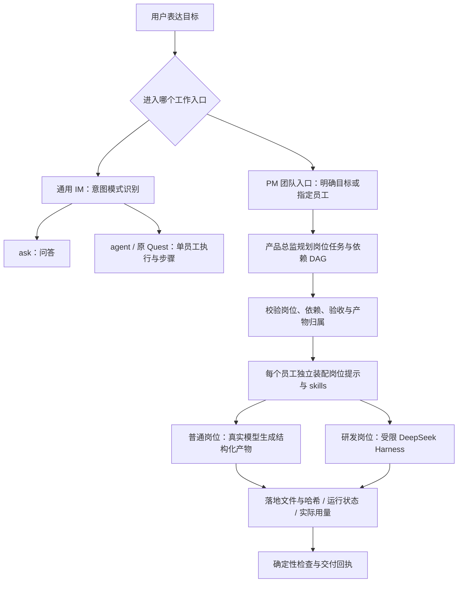

<div align="center">

# WorkLoom PM

**AI 产品经理带领一支 AI 研发团队，从用户意图到真实产物、验证与交付回执。**

你提出目标和边界，产品经理组织需求、研发、质量与交付；每个结论有来源，每个产物可检查，每次失败可追踪。

[English](README_EN.md) · [交付架构](docs/PM-DELIVERY.md) · [真实评测与边界](docs/PM-EVALUATION.md) · [Apache-2.0](LICENSE)

</div>

WorkLoom PM 面向产品负责人、创业者和小型研发团队。它完整继承 WorkLoom IM 的源码、数字员工、技能、三端界面、桌面壳与治理机制，把默认产品聚焦到一件事：**让 AI 产品经理对一项需求的交付负责，并组织不同岗位协作完成。**

正式工作入口是 PC 工作台的 **「开发场域」`/development`**：PM 团队视图用于目标、任务图、执行与产物；原有 DevFabric 开发场域保留为可切换的工作模式。桌面客户端与浏览器开发入口共享服务端。

Codex 等 Agent 可通过 **`pnpm pm:agent` JSON CLI 或 `pnpm pm:agent:mcp` stdio 服务**直接调用同一 PM 后端，完成岗位查询、提交目标、执行、等待和核对原始产物。成员会话从进程环境注入；调用保留现有权限、围栏和预算，机器回执通过后仍需语义验收。接入方式与请求示例见 [PM Agent 调用指南](docs/pm-agent.md)。

本仓的交付证据以 [PM-EVALUATION.md](docs/PM-EVALUATION.md) 中标明的源码、模型、样本与实际结果为准。岗位定义、技能文件、演示种子和历史测试徽章都不能代替一次真实交付；本 README 不把它们换算成成功率，也不宣称已有签名安装包。

## 给谁用，解决什么问题

当你已经能让一个 AI 写文档或写代码，下一步经常卡在三处：需求没有被写成可验证的目标；不同角色之间靠人复制上下文；模型说“完成了”，但文件、测试和交付状态对不上。

WorkLoom PM 把这三处变成明确的工作对象：产品经理维护目标和验收标准，员工各自带着岗位和技能执行，任务依赖与产物回执把工作连接起来。人类负责业务方向、预算与授权；系统在允许的范围内持续推进，遇到失败保留原因与证据。

| 具体场景 | 团队怎样工作 | 交付时检查什么 |
|---|---|---|
| **把一段模糊想法变成可执行需求**：“给我们的内部工具增加反馈入口，先把范围和验收说清楚。” | 需求分析官梳理用户、目标与边界；文档主笔官产出 PRD；产品总监汇总取舍 | PRD 文件、明确的不做清单、可检验的验收条目；缺信息时保留假设 |
| **交付一个边界明确的小项目**：“在隔离目录实现一个任务清单页面，附使用说明和验收证据。” | 产品总监拆成有依赖的岗位任务；开发总指挥驱动受限研发执行；质量与文档岗位接续 | 实际代码文件、内容摘要、文件哈希、已运行的检查及其结果；未运行的检查明确标出 |
| **完成一次跨岗位迭代**：“汇总这些反馈，确定本轮改动，实施后给出回归结论与发布说明。” | 用户倾听官归类反馈，需求分析官定义范围，开发总指挥实施，模型评测官与发布护航官分别检查质量和交付资料 | 上游反馈与下游改动的对应关系、依赖产物、回归证据、已知问题和最终交付单 |

这些是可投喂的任务形态。具体任务是否达成，要看对应运行的产物与检查结果；研究外部竞品需要真实检索，检查业务指标需要真实数据源，发布到外部系统需要相应连接器与授权。

## 从意图到交付：每一层负责什么

本仓保留通用 IM 的 `ask / agent / quest` 意图模式，并增加独立的 PM 团队交付入口。**模式识别、选择岗位、拆分依赖和执行工具是不同职责。**



- **意图模式**决定这一句话是问答、单员工任务还是需要持续推进的目标。通用路由位于 [`packages/runtime/src/intent.ts`](packages/runtime/src/intent.ts)。
- **原 Quest**拆分的是同一个员工执行的步骤；它本身不能作为“已经具备跨员工团队 DAG”的证据。
- **PM 团队层**位于 [`apps/server/src/industry/ai-pm/`](apps/server/src/industry/ai-pm/)。独立 `/api/pm` 入口接收完整目标；不指定员工时，产品总监生成受约束的岗位任务图；指定员工时，直接形成该员工的单任务。它没有把旧意图分类器再串行调用一次来假装“经理”。
- **岗位装配**给每个任务注入对应员工的岗位提示、技能正文和已完成依赖的产物。技能是 SOP 与边界说明，**不会因为写在 SKILL.md 中就自动获得网络、数据库或 shell 权限**。
- **模型与 Harness**执行具体工作。普通岗位使用真实 DeepSeek 生成结构化文件内容；开发总指挥的研发节点使用受限 dsh。Harness 负责模型与工具之间的循环，PM 团队层负责岗位、依赖、预算与交付状态。
- **完成判定**依赖真实文件、哈希、检查和回执。缺少用量、超时、取消、产物漂移或检查失败不能被记成成功。恢复任务时重新检查已有产物，不能只相信旧状态。

团队计划按依赖拓扑推进；多岗位参与不等于同时并发。当前的执行、恢复、工具范围与数据落账细节见 [PM 交付架构](docs/PM-DELIVERY.md)。

## 现有团队：14 个岗位，20 个技能

事实源是 [`bundles/ai-pm/bundle.json`](bundles/ai-pm/bundle.json)、[`presets/`](bundles/ai-pm/presets/) 和 [`skills/`](bundles/ai-pm/skills/)。这支团队以产品总监为责任人，覆盖情报、定义、研发统筹、质量、交付与学习。

| 数字员工 | 岗位 ID | 已声明技能 | 岗位负责的具体工作 |
|---|---|---|---|
| 产品总监 | `chief-pm` | `metric-digest`、`meeting-digest`、`prd-forge` | 接住目标，组织计划、优先级、协作与交付结论 |
| 需求分析官 | `requirement-analyst` | `prd-forge` | 需求分诊、价值与成本初评、验收条目化 |
| 竞品侦察官 | `competitor-scout` | `competitor-scan`、`industry-radar` | 竞品变化对比、来源核实与威胁研判 |
| 数据洞察官 | `data-insight` | `metric-digest` | 指标摘要、异动与日报周报 |
| 用户倾听官 | `user-listener` | `review-miner` | 反馈聚类、代表原声与回复草稿 |
| 文档主笔官 | `doc-writer` | `prd-forge`、`release-notes` | PRD、文档与发布说明 |
| 行业瞭望官 | `industry-radar` | `industry-radar` | 行业、模型、工具链与政策信号 |
| 开发总指挥 | `dev-orchestrator` | `dev-dispatch`、`session-watch`、`changeset-harvest`、`release-cut`、`prd-forge` | 拆开发任务、派发研发执行、回收改动与组织返修 |
| 发布护航官 | `release-guardian` | `release-notes`、`github-pulse` | 交付检查单、变更说明与风险提示 |
| 模型侦察官 | `model-scout` | `model-scout`、`industry-radar` | 用产品场景比较模型质量、时延与成本 |
| 模型评测官 | `eval-master` | `eval-forge`、`badcase-harvest`、`finetune-tracker` | 验收案例、评测回归、失败归因与微调前置评估 |
| 提示词主理官 | `prompt-curator` | `prompt-regression` | 提示词版本、回归差异与回滚资料 |
| 红队官 | `red-teamer` | `redteam-scan` | 隔离环境的注入、越权与边界对抗检查 |
| 知识保鲜官 | `knowledge-curator` | `kb-fresh`、`learning-digest` | 过期知识巡检、学习周刊与经验固化建议 |

**当前名册没有独立的“前端工程师”“后端工程师”岗位。** 研发实现由开发总指挥组织研发执行器承担；不能把一个模型扮演了几个工程角色写成名册里已有这些员工。

20 个技能按工作对象分组：

| 工作对象 | 技能 ID |
|---|---|
| 需求与文档 | `prd-forge`、`meeting-digest`、`release-notes` |
| 情报与数据 | `competitor-scan`、`industry-radar`、`review-miner`、`metric-digest`、`github-pulse`、`model-scout` |
| 研发与交付 | `dev-dispatch`、`session-watch`、`changeset-harvest`、`release-cut` |
| 质量与模型治理 | `eval-forge`、`badcase-harvest`、`prompt-regression`、`redteam-scan`、`finetune-tracker` |
| 组织学习 | `kb-fresh`、`learning-digest` |

这张表描述岗位与技能的约定。原包中部分技能还包含演示、人工裁决或未联调连接器的路径；**20 个技能文件齐全，不等于 20 条外部业务闭环均已生产验收**。默认 Bundle 仍保留上游的示例与候选元数据，具体真实运行范围见评测报告。

## DeepSeek 与 Harness 的分工

默认真实驱动模型为 **`deepseek-flash`**。DeepSeek 官方在 2026-10-23 的文档中说明，该 API 别名当前由 **DeepSeek-V4.1-Flash-1017** 提供服务；它会随供应商更新，不能当作不可变的版本锁。评测须记录请求模型、响应模型、请求 ID、实际用量与时间。[官方模型接入说明](https://api-docs.deepseek.com/)

[`providers.ts`](packages/base/model-router/providers.ts) 保留完整的 assistant/tool 消息、`reasoning_content` 和用量；多轮工具调用不会只留下最终一句文本。真实调用缺密钥、缺用量、超时或协议不完整时会失败，不会静默换成演示模型。

搜索与抓取通过显式的 `deepseek_search` / `deepseek_fetch` 函数工具接入 DeepSeek 自营 Search/Fetch API。**支持搜索工具不代表所有请求都自动联网**；岗位需要检索时，必须在允许的工具集合中调用并保留来源。Flash 会忽略 Responses API 原生 `web_search`，因此不能仅添加这个字段就宣称已经检索。[Search & Fetch 文档](https://api-docs.deepseek.com/guides/search/) · [Responses 兼容说明](https://api-docs.deepseek.com/guides/responses_api/)

DeepSeek Harness 是工具执行循环与会话机制，不是第二个产品经理。研发节点在隔离工作目录内使用明确允许的文件工具；宿主机任意命令、生产数据和外部发布不因接入模型而开放。岗位协作、DAG、产物所有权与最终验收由 PM 团队层维护。

**客户端内置模型适配与默认配置，不内置共享明文 API Key。** 真实 Key 由启动进程环境或受控本地密钥管理注入，不进入源码、浏览器资源、README、日志或安装包。

## 源码运行

需要 **Node.js 24 或以上、仓库固定的 pnpm 10.14.0、PostgreSQL 17 与 pgvector**。依赖以 [`package.json`](package.json) 和 [`pnpm-lock.yaml`](pnpm-lock.yaml) 为准；首次安装保持锁文件，不使用“升级到最新”代替复现环境。

```bash
git clone https://github.com/geniusdapeng-collab/workloom-pm.git
cd workloom-pm
pnpm install --frozen-lockfile
cp .env.example .env
```

先把 `.env` 中的 `DATABASE_URL`、`DATABASE_APP_URL`、`DATABASE_GATEWAY_URL` 指向**本项目独立的数据库**，并设置专用的 `APP_DB_PASSWORD`、`GATEWAY_DB_PASSWORD`。连接串与两个角色密码中的占位符必须全部替换，再执行：

```bash
pnpm db:migrate
pnpm db:seed:aipm
```

默认仍使用 `ai-pm` Bundle、`ai-pm-demo` 工作区和原成员编号，便于继承已有种子与界面契约。示例数据用于体验与测试，必须和真实输入、真实交付分开标识。

真实 PM 运行的非秘密配置是：

```dotenv
LLM_PROVIDER=deepseek
LLM_BASE_URL=https://api.deepseek.com
LLM_MODEL=deepseek-flash
```

启动前通过受控方式向进程注入 `DEEPSEEK_API_KEY`，也兼容 `LLM_API_KEY`；不要把真实 Key 填进公开文件或带 Key 的命令示例。随后启动桌面源码入口：

```bash
pnpm app:dev
```

源码启动器读取根 `.env`，由显式进程环境覆盖，统一传给 server、Web 与 Electron；默认端口由产品清单偏移派生。浏览器开发使用 `SERVER_PORT=8987 WEB_PORT=5373 pnpm dev`，进入 `http://localhost:5373/development`；自定义端口时同步调整启动进程变量。`pnpm app` 构建 Web 后打开 Electron，`pnpm app:dev` 使用 HMR，`pnpm app --smoke` 只验证源码服务与主进程，不等于安装包渲染或签名验收。

桌面首屏由受控产品清单的 `desktop.startPath` 指向 `/development`，源码与安装包使用同一路由；可用 `WORKLOOM_START_PATH` 显式选择安全的本地路径。原经营首页仍可从导航打开。本产品把 `clients.bPc.secretaryAutoScan` 设为 `false`，停用浏览页面时的秘书自动写入扫描；已有收件箱仍每 20 秒刷新，用户主动发起的助手操作保持可用。

独立产品身份为 `workloom-pm`，桌面 appId 为 `com.workloom.pm`，偏移为 `200`。打包默认端口为 server `8987`、web `5373`、PG `5632`、NATS `4422`；源码数据库仍以你配置的连接串为准。源码客户端默认支持目录按系统应用目录下的 `workloom-pm` 隔离；可用 `WORKLOOM_SUPPORT_DIR` 显式覆盖。Electron 名称与快捷方式也使用独立产品身份。

上游 `setup` / `preview:all` 脚本及其它行业演示完整保留。`preview:all` 是继承的演示预览路径，不能用它的“就绪”横幅证明真实 PM 交付；它与已有 IM 开发实例的端口和数据库关系，应先按本仓现行配置核实。

### 验证与评测

```bash
pnpm typecheck
pnpm test
pnpm pm:budget:test
pnpm product:verify
pnpm runtime:deps:verify
```

真实任务评测使用 `pnpm pm:eval`，具体模型、费用硬闸、隔离路径、任务清单与判定规则见 [PM-EVALUATION.md](docs/PM-EVALUATION.md)。评测至少区分：单员工产物是否合格、跨员工计划是否有效、依赖是否被消费、研发产物是否实际落地、确定性检查是否执行、失败与恢复是否保留证据。输出率、路由召回率和端到端达成率分别计算，不能互相替代。

## 范围与边界

| 优先级 | 要做的具体行为 | 用户得到什么 |
|---|---|---|
| P0 | 提交完整目标或指定岗位；生成并校验团队计划；带技能逐节点执行；产出真实文件与检查回执 | 降低人类在角色之间搬运上下文与核对“是否真的完成”的负担 |
| P0 | 给模型与研发工具设置费用、调用次数、路径和超时边界；失败明确停在对应节点 | 让一次任务的投入与影响范围可控 |
| P1 | 持续扩大真实任务集、路由评测集和构建/功能验证覆盖；完善长任务恢复与质量回归 | 以持续实测判断哪些目标可以放心交给团队 |
| P2 | 在已验证的权限与数据边界内扩展外部研发、发布与知识连接器 | 将已证实的交付能力接入更多真实工作流 |

本轮不把任意互联网软件项目、无人批准的生产发布、跨企业数据汇聚、资金或客户外发纳入默认自治范围。付费真实模型也不意味着所有外部连接器已开通。安装包仍须走载荷、签名、公证与发布门禁；源码运行通过不能替代这些证据。

## 仓库与继承关系

本仓从 [WorkLoom IM](https://github.com/geniusdapeng-collab/workloom-im) 完整复制，导入基线为 `e5d76398484cac7d8ac50b6c27905765a59fd50f`。服务端、三端、桌面、数据库迁移、所有 Bundle、技能、vendor、脚本、测试与历史文档均保留；默认工作对象调整为 PM 团队交付，非默认的 `hotel` / `platform` 资产仍在树中。

| 路径 | 在本项目中的作用 |
|---|---|
| `apps/server/src/industry/ai-pm/` | PM 团队计划、岗位执行、产物与任务接口 |
| `bundles/ai-pm/` | 14 岗位、20 技能及围栏、业务对象、种子 |
| `packages/runtime/` | 通用意图路由、岗位装配、单员工 Ask/Agent/Quest 与 dsh 适配 |
| `packages/base/model-router/` | 真实模型协议、用量、工具循环与 DeepSeek Search/Fetch |
| `packages/base/workdata/` | 本地事件、组织记忆、PII 与租户边界 |
| `packages/db/` | 迁移与数据结构 |
| `apps/web`、`apps/webb`、`apps/webc` | PC、移动 B 与移动 C 客户端 |
| `apps/desktop/` | Electron 客户端与内嵌运行时启动 |
| `vendor/`、`scripts/`、`docs/` | 上游运行时基线、工程工具与可追溯文档 |

[原中文 README](docs/UPSTREAM-README.md) 与 [原英文 README](docs/UPSTREAM-README_EN.md) 按导入时原文保留。它们以及受控全景文档中的旧仓库、CNB、安装包和历史数量属于上游快照，**不代表 WorkLoom PM 当前已经完成的发布或验收**。现行产品身份以 [`product.manifest.json`](product.manifest.json) 为准，PM 交付证据见本仓两份 PM 文档。

下方为继承的基座能力目录，由生成器维护；它描述代码入口，不能当作 PM 真实任务通过率。本产品首次源码启动使用上文的 `pnpm app:dev`；自动块内保留的 `preview:all` 首启提示属于上游快照。修改能力面后运行 `pnpm capabilities` / `pnpm capabilities:check`。

<!-- CAPABILITIES:BEGIN -->
<!-- 本区块由 scripts/generate-capabilities.mjs 自动生成（2026-10-24），请勿手改；重跑 pnpm capabilities 更新 -->

## 🧩 系统能力速览（自动生成 · 与代码同步）

> 以下为源码目录与入口清单；实际调用及结果状态见能力导览的独立证据字段，未验证项不能作交付承诺。

- 🖥 **三端应用入口**：PC 端 · B 端工作台 · 移动端 · B 端高保真 · 移动端 · C 端 AI 服务前台
- 🧭 **PM 任务调用（CLI / MCP）**：PM JSON CLI · PM MCP stdio
- 🏨 **行业 Bundle（垂直能力包）**：bundles/ai-pm/ · bundles/hotel/ · bundles/platform/
- 🧑‍💼 **数字员工与数字人（本仓自带）**：数字员工中心（`/agents`） · 织伴数字人（Live2D 常驻浮层） · 语音与口型引擎 · Live2D 渲染后端与资产
- 🖐 **操作电脑能力（本仓自带 · 可装生产工作站）**：computer-use 三层感知入口 · HTTP 远程驱动 + MCP server
- 🤖 **AI 自动化引擎（系统内置能力）**：围栏 DSL 引擎 · 技能保鲜环（下行分发） · L2 编排（ASK/QUEST） · 夜班自动运行 · 模型路由 · 五元事件 + RLS 隔离 等 10 项
- ✅ **验证与质量（工程纪律）**：一键安装（bootstrap） · 主测试套件 · 发布门禁 · 五元事件验链 · Agent 能力巡游 · 环境自检
- 🎁 **演示与交付资产**：高保真演示页 ×6 · 官网静态站 · 自带技能 ×5 · 能力导览 PPT · Mock 数据体系

> 📖 完整能力导览（含截图与体验路径）：[docs/capabilities.auto.md](docs/capabilities.auto.md) ｜ 🤖 AI Agent 入口：[AGENTS.md](AGENTS.md) ｜ 🎯 首启必跑：`pnpm preview:all`
<!-- CAPABILITIES:END -->

## 许可与来源

本仓遵循 [Apache-2.0](LICENSE)。DeepSeek Harness、dsh-im 等 vendored 项目保留各自许可和来源。感谢 [DeepSeek Harness](https://github.com/deepseek-ai/deepseek-harness)、[pgvector](https://github.com/pgvector/pgvector) 及 WorkLoom IM 的原始工程基础。
