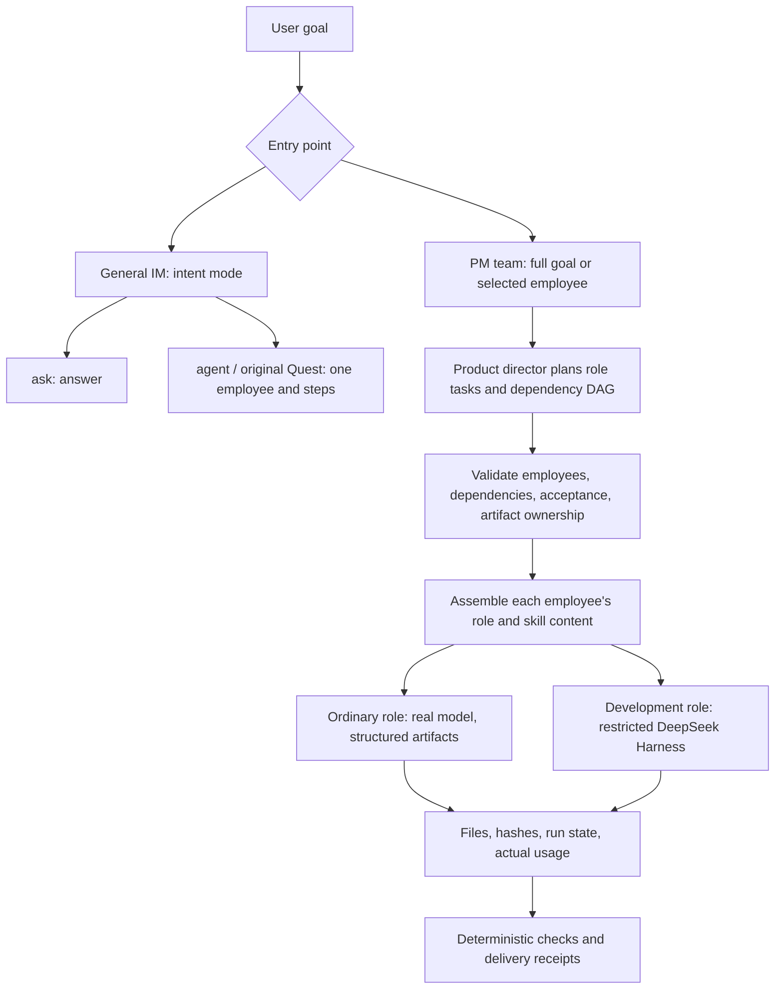

<div align="center">

# WorkLoom PM

**An AI product manager leads an AI development team from a goal to an executable task graph, real artifacts, independent verification, and traceable delivery receipts.**

You supply the goal and boundaries. The product manager coordinates requirements, implementation, quality, and delivery. The system reports not only what it did, but also who did it, which material was consumed, which files were produced, which checks ran, and what remains unverified.

[简体中文](README.md) · [Core capabilities](#core-capabilities-from-a-goal-to-verifiable-delivery) · [Delivery architecture](docs/PM-DELIVERY.md) · [218-task evaluation](docs/DEEPSEEK-218-EVALUATION.md) · [Apache-2.0](LICENSE)

</div>

WorkLoom PM is for product owners, founders, and small development teams. It is not a single-purpose writing or coding assistant. It connects **goal clarification, role coordination, restricted execution, quality verification, and release gates** into one AI product-development workflow.

The PC workspace entry is **Development, `/development`**. The PM team view presents goals, task dependencies, execution, and artifacts. The original DevFabric development workspace remains available as another view. Desktop and browser development clients use the same server.

For actual delivery results, use the source revision, model, samples, and evidence recorded in [PM-EVALUATION.md](docs/PM-EVALUATION.md). Employee definitions, skill files, seeded examples, and historical test badges do not establish a live success rate. This README does not advertise a signed WorkLoom PM installer.

> **Core promise: progress is visible, but completion cannot be fabricated.** Completion must map to real files, deterministic checks, actual model usage, and a readable receipt. Missing evidence, timeouts, cancellation, artifact drift, and failed checks remain incomplete.

## Core capabilities: from a goal to verifiable delivery

| Capability | What the system actually does | What the user gets |
|---|---|---|
| **Product-manager ownership** | The product director accepts a complete goal, asks for clarification when needed, creates a role/dependency DAG, and validates roles, dependencies, acceptance, artifact ownership, and stop conditions | Less manual copying of context between AI roles |
| **Real role and skill assembly** | Fourteen employees cover decisions, requirements, competitors, data, users, documents, development, evaluation, release, models, prompts, red teaming, and knowledge governance. Every task is assembled with its own prompt and matching SOP from twenty skills | Work is assigned to the corresponding responsibility instead of renaming one assistant |
| **Real model and attributable sources** | The default is `deepseek-flash`, with requested model, returned model, response ID, usage, finish state, and latency stored per request. Online facts require explicit Search/Fetch calls with retained sources | You can verify whether the model was called, how much it used, and whether retrieval really happened |
| **Restricted development execution** | Development roles use a pinned DeepSeek Harness with explicit tools such as `list_files`, `read_file`, and `write_file`, constrained to the task directory. Host shell, production data, and external publishing remain closed | Models can land code without receiving unrestricted control of the computer |
| **Artifact-first receipts** | Files, SHA-256, size, ownership, run state, dependency artifacts, model usage, and every check are persisted. Resume revalidates files instead of trusting an old status | Clear separation between generated text and a checkable deliverable |
| **Built-in governance** | Tenant/workspace RLS, append-only five-dimension events, PII masking, `block > review > auto` fences, human review for high-risk actions, and runtime-only credentials | Permission, audit, and data-flow boundaries do not depend on prompt obedience |
| **Budgets, recovery, and fail-closed behavior** | Calls, tokens, cost, wall clock, paths, and timeouts are bounded. Unknown outcomes freeze later paid calls, and restart preserves the budget ledger | Long-running work has controllable cost, recovery state, and visible failure reasons |
| **Repeatable quality evaluation** | A fixed 218-task cross-role suite covers ten live Search cases and eight independently executed code tasks, alongside type checks, repository tests, three production builds, and release gates | Capabilities can be measured repeatedly instead of inferred from a demo screenshot |
| **Three clients and desktop** | PC workspace, B-side mobile, C-side service front, and the Electron shell share product identity and server contracts | The same task and data can be inspected across development, mobile, and desktop surfaces |

### How to read these capabilities

| Status | Meaning |
|---|---|
| **Verified in this repository** | Team planning, role assembly, restricted DSH, artifact receipts, the budget gate, repository tests, three production builds, the release gate, and the fixed 218-task suite have current execution or deterministic gate evidence |
| **Requires additional configuration or authorization** | Customer databases, production connectors, external publishing, and signed/notarized installers require deployment credentials, permissions, and separate acceptance. An available code entry does not mean the integration is already enabled |
| **Not claimed** | Fully autonomous end-to-end delivery of arbitrary complex projects, one-shot success on Internet-scale projects, unapproved production releases, cross-company data aggregation, financial actions, or a first-pass 100% result on the 218 tasks |

The end-to-end boundary remains separate: the original PM evaluation still records both multi-role long goals as 0/2. Successful roles, files, or individual tasks do not turn the complete project workflow into a pass. The retained failures are documented in [PM-EVALUATION.md](docs/PM-EVALUATION.md).

After preserving an initial 126/218 result, the fixed suite reached 218/218 through real reruns, code repairs, and evaluator repairs; Search was 10/10 and the code sandbox was 8/8. This result applies only to the fixed suite and does not establish the same success rate for arbitrary business work. See [the DeepSeek 218 evaluation](docs/DEEPSEEK-218-EVALUATION.md) for methodology and limits.

## Who it helps

A single AI assistant can already draft a document or write code. Coordinating a delivery adds three recurring problems: turning a request into testable requirements, carrying context between roles, and checking whether “done” corresponds to real files and actual verification.

WorkLoom PM represents those explicitly. The product manager owns the goal and acceptance criteria; employees execute with their own roles and skills; dependency artifacts and receipts connect the work. Humans retain business direction, budget, and authorization. The system proceeds within its permitted scope and preserves evidence when a step fails.

| Concrete scenario | How the team works | What must be checked |
|---|---|---|
| **Turn an idea into an actionable requirement:** “Add a feedback entry to our internal tool; define scope and acceptance first.” | The requirements analyst identifies users, goals, and limits; the documentation writer produces a PRD; the product director consolidates decisions | A real PRD file, explicit exclusions, testable acceptance criteria, and disclosed assumptions |
| **Deliver a bounded small project:** “Implement a task-list page in an isolated directory, with usage instructions and evidence.” | The product director creates role tasks with dependencies; the development orchestrator drives restricted implementation; quality and documentation roles follow | Actual code files, artifact hashes, checks that were really run, and clearly identified checks that were not run |
| **Complete an iteration across roles:** “Summarize these feedback items, define this iteration, implement it, and return regression findings and release notes.” | User feedback is grouped, requirements are defined, implementation follows, and evaluation and release roles inspect different parts | Traceable feedback-to-change relationships, consumed dependency artifacts, regression evidence, known issues, and a final delivery record |

These are task shapes to evaluate, not blanket promises of success. External competitor research needs real retrieval; business metrics need a connected data source; external publication needs an authorized connector.

## From intent to delivery

The inherited IM runtime retains `ask / agent / quest` intent modes. The PM team workflow has a separate delivery entry. **Mode classification, employee selection, dependency planning, and tool execution have different responsibilities.**



- **Intent mode** selects a conversational or task mode. The general classifier lives in [`packages/runtime/src/intent.ts`](packages/runtime/src/intent.ts).
- **The original Quest** decomposes work into steps for one employee. Its existence does not establish a multi-employee DAG scheduler.
- **The PM team layer**, in [`apps/server/src/industry/ai-pm/`](apps/server/src/industry/ai-pm/), receives a complete goal through its independent `/api/pm` entry. Without an explicit employee, the product director produces a constrained role plan. Selecting an employee produces a single-employee task. This does not add another serial invocation of the old intent classifier and call it a manager.
- **Employee assembly** supplies that employee's role prompt, skill text, and completed dependency artifacts. A skill is an SOP and a boundary description. Its text does not automatically grant network, database, or shell access.
- **The model and Harness** perform the work. Ordinary roles use real DeepSeek responses to create structured file content. Development-orchestrator nodes use restricted dsh execution. Harness owns the model/tool loop; the PM layer owns employees, dependencies, budgets, and delivery state.
- **Completion** requires real artifacts, hashes, checks, and receipts. Missing usage, timeouts, cancellation, artifact drift, and failed checks must not become successful deliveries. Resume rechecks artifacts rather than trusting an old status alone.

Tasks progress in dependency order. Multiple participating employees do not imply simultaneous execution. See [PM-DELIVERY.md](docs/PM-DELIVERY.md) for execution, recovery, tool restrictions, and persistence details.

## The actual workforce: 14 roles and 20 skills

The sources of truth are [`bundles/ai-pm/bundle.json`](bundles/ai-pm/bundle.json), [`presets/`](bundles/ai-pm/presets/), and [`skills/`](bundles/ai-pm/skills/). The product director coordinates intelligence, requirements, development orchestration, quality, delivery, and learning.

| Employee | Preset ID | Declared skills | Responsibility |
|---|---|---|---|
| Product director / 产品总监 | `chief-pm` | `metric-digest`, `meeting-digest`, `prd-forge` | Goals, priorities, coordination, and delivery conclusions |
| Requirements analyst | `requirement-analyst` | `prd-forge` | Requirement triage, value/cost review, acceptance criteria |
| Competitor scout | `competitor-scout` | `competitor-scan`, `industry-radar` | Competitor changes, sources, and threat assessment |
| Data analyst | `data-insight` | `metric-digest` | Metrics, anomalies, and reports |
| User listener | `user-listener` | `review-miner` | Feedback groups, representative quotes, and reply drafts |
| Documentation writer | `doc-writer` | `prd-forge`, `release-notes` | PRDs, documentation, and release notes |
| Industry scout | `industry-radar` | `industry-radar` | Industry, model, tooling, and policy signals |
| Development orchestrator / 开发总指挥 | `dev-orchestrator` | `dev-dispatch`, `session-watch`, `changeset-harvest`, `release-cut`, `prd-forge` | Development task decomposition, executor dispatch, change collection, and repair coordination |
| Release guardian | `release-guardian` | `release-notes`, `github-pulse` | Delivery checklists, change notes, and release risks |
| Model scout | `model-scout` | `model-scout`, `industry-radar` | Product-specific model quality, latency, and cost comparisons |
| Model evaluator | `eval-master` | `eval-forge`, `badcase-harvest`, `finetune-tracker` | Acceptance cases, regression, failure analysis, and fine-tuning assessment |
| Prompt curator | `prompt-curator` | `prompt-regression` | Prompt versions, regression differences, and rollback evidence |
| Red-team auditor | `red-teamer` | `redteam-scan` | Isolated injection, permission, and boundary tests |
| Knowledge curator | `knowledge-curator` | `kb-fresh`, `learning-digest` | Stale knowledge, learning digests, and improvement proposals |

**The current roster does not contain separate frontend-engineer or backend-engineer presets.** Implementation is organized by the development orchestrator and its development executor. Having a model perform several engineering activities does not create additional employees in the roster.

The 20 skills are:

| Work area | Skill IDs |
|---|---|
| Requirements and documents | `prd-forge`, `meeting-digest`, `release-notes` |
| Intelligence and data | `competitor-scan`, `industry-radar`, `review-miner`, `metric-digest`, `github-pulse`, `model-scout` |
| Development and delivery | `dev-dispatch`, `session-watch`, `changeset-harvest`, `release-cut` |
| Quality and model governance | `eval-forge`, `badcase-harvest`, `prompt-regression`, `redteam-scan`, `finetune-tracker` |
| Organizational learning | `kb-fresh`, `learning-digest` |

This catalog describes role and SOP contracts. Some inherited skills include demonstration paths, human decisions, or connectors that have not been independently integrated and verified. Twenty complete skill files do not mean twenty production workflows have passed acceptance. The default Bundle retains its upstream example/candidate metadata; the evaluation report defines the actual live coverage.

## DeepSeek and Harness

The default real model is **`deepseek-flash`**. DeepSeek's documentation observed on 2026-10-23 maps this alias to **DeepSeek-V4.1-Flash-1017**. The provider can update the alias, so it is not an immutable version pin. Evaluation records the requested model, returned model, request ID, actual usage, and time. [Official model guide](https://api-docs.deepseek.com/)

[`providers.ts`](packages/base/model-router/providers.ts) preserves complete assistant/tool messages, `reasoning_content`, and usage. Missing keys, missing usage, incomplete protocol responses, and timeouts fail instead of silently selecting a demonstration model.

The explicit `deepseek_search` and `deepseek_fetch` function tools call DeepSeek's own Search/Fetch API. **Having search tools does not mean every request automatically searches the web.** A permitted role must invoke retrieval and retain sources. Flash ignores the Responses API's native `web_search` tool; adding that field alone does not prove that retrieval happened. [Search & Fetch](https://api-docs.deepseek.com/guides/search/) · [Responses compatibility](https://api-docs.deepseek.com/guides/responses_api/)

DeepSeek Harness provides a model/tool execution loop and sessions. It is not another product manager. Development nodes pin `@deepseek-ai/dsh@0.2.1-rc.2` and operate within an isolated working directory and an explicit file-tool scope. Connecting a model does not open arbitrary host commands, production data, or external publishing. The PM team layer manages the role DAG, artifact ownership, and acceptance.

**The client includes a model adapter and defaults, not a shared plaintext API key.** Inject the real key through the launch environment or controlled local secret management. It must not enter source code, browser assets, documentation, logs, or installer files.

## Run from source

Requirements: **Node.js 24 or later, the repository's pinned pnpm 10.14.0, PostgreSQL 17, and pgvector**. Use [`package.json`](package.json) and [`pnpm-lock.yaml`](pnpm-lock.yaml); reproduce the lock instead of upgrading dependencies as part of installation.

```bash
git clone https://github.com/geniusdapeng-collab/workloom-pm.git
cd workloom-pm
pnpm install --frozen-lockfile
cp .env.example .env
```

Point `DATABASE_URL`, `DATABASE_APP_URL`, and `DATABASE_GATEWAY_URL` in `.env` at a **database dedicated to this project**. Set dedicated `APP_DB_PASSWORD` and `GATEWAY_DB_PASSWORD` values, replacing every connection-string and role-password placeholder before running:

```bash
pnpm db:migrate
pnpm db:seed:aipm
```

The default Bundle stays `ai-pm`; the workspace stays `ai-pm-demo`, preserving seed and client compatibility. Seeded examples remain distinct from real input and real delivery evidence.

Non-secret model configuration:

```dotenv
LLM_PROVIDER=deepseek
LLM_BASE_URL=https://api.deepseek.com
LLM_MODEL=deepseek-flash
```

Inject `DEEPSEEK_API_KEY` into the launch process through your controlled mechanism; `LLM_API_KEY` is also accepted. Do not put a real key into a published file or a command example. Start the desktop development entry:

```bash
pnpm app:dev
```

The source launcher reads the root `.env`, applies explicit process overrides, and passes the resolved configuration to the server, Web client, and Electron. Default ports derive from the product manifest offset. For browser development, run `SERVER_PORT=8987 WEB_PORT=5373 pnpm dev` and open `http://localhost:5373/development`; update both process variables when using custom ports. `pnpm app` builds the Web client and opens Electron; `pnpm app:dev` uses HMR. `pnpm app --smoke` checks source services and the Electron main process; it does not replace packaged rendering, signing, or notarization acceptance.

The controlled product manifest sets `desktop.startPath` to `/development` for both source and packaged desktop launches. `WORKLOOM_START_PATH` can explicitly select another safe local route. The original operating home remains accessible from navigation. This product sets `clients.bPc.secretaryAutoScan` to `false`, disabling automatic secretary writes while browsing. Existing inbox items still refresh every 20 seconds, and user-initiated assistant actions remain available.

Product identity is `workloom-pm`, desktop appId is `com.workloom.pm`, and port offset is `200`. Packaged defaults are server `8987`, Web `5373`, PostgreSQL `5632`, and NATS `4422`. Source databases use the configured connection strings. Source-client support data defaults to `workloom-pm` under the operating system application-data directory; `WORKLOOM_SUPPORT_DIR` provides an explicit override. The Electron name and shortcuts use the independent product identity.

Inherited `setup`, `preview:all`, and other industry demonstrations are retained. `preview:all` is an inherited demonstration path; its readiness banner cannot establish real PM delivery. Check its current ports and database configuration before using it alongside an existing IM development instance.

### Validate and evaluate

```bash
pnpm typecheck
pnpm test
pnpm pm:budget:test
pnpm product:verify
pnpm runtime:deps:verify
```

Use `pnpm pm:eval` for real task evaluation. [PM-EVALUATION.md](docs/PM-EVALUATION.md) defines the model, budget gates, isolated directories, task set, and assertions. Distinguish single-employee artifact quality, valid team planning, dependency consumption, real implementation artifacts, executed deterministic checks, and failure/recovery evidence. Routing recall, output production, and end-to-end task success are separate metrics.

Run the 218-case cross-role suite with `pnpm pm:deepseek:218`. It spans 14 role families and four difficulty levels, includes 10 live Search cases and eight implementations checked by the independent code sandbox, and preserves every request, usage record, source, assertion, failure, and repair phase. See [the DeepSeek 218 evaluation report](docs/DEEPSEEK-218-EVALUATION.md) for results and evidence boundaries.

## Scope

| Priority | Concrete behavior | User value |
|---|---|---|
| P0 | Submit a full goal or select an employee; validate a team plan; run role/skill tasks; produce actual files and check receipts | Less manual context transfer and less guesswork about whether work happened |
| P0 | Bound model and development execution by cost, calls, paths, and deadlines; preserve the failed node and reason | Controlled cost and impact per task |
| P1 | Expand live task and routing datasets, build/function checks, recovery, and quality regression coverage | Evidence for which goals can reliably be delegated |
| P2 | Add external development, publishing, and knowledge connectors within verified permissions and data boundaries | Extend proven workflows into more real systems |

Arbitrary internet-scale projects, unapproved production releases, cross-company data aggregation, financial actions, and customer outbound communication are outside the default autonomous scope. A paid model connection does not activate every external connector. Installers still require payload, signing, notarization, and release gates; running from source cannot establish those results.

## Repository and provenance

This repository is a complete copy of [WorkLoom IM](https://github.com/geniusdapeng-collab/workloom-im), imported from `e5d76398484cac7d8ac50b6c27905765a59fd50f`. Server, three clients, desktop, migrations, every Bundle and skill, vendor code, scripts, tests, and historical documents remain present. PM team delivery is the product focus; the inherited `hotel` and `platform` assets also remain in the tree.

| Path | Responsibility |
|---|---|
| `apps/server/src/industry/ai-pm/` | Team plans, employee execution, artifacts, and PM task API |
| `bundles/ai-pm/` | Fourteen roles, twenty skills, fences, objects, and seeds |
| `packages/runtime/` | General intent routing, preset assembly, single-employee modes, and dsh adaptation |
| `packages/base/model-router/` | Real model protocol, usage, tool conversations, Search/Fetch |
| `packages/base/workdata/` | Local events, organizational memory, PII, and tenant boundaries |
| `packages/db/` | Migrations and data structure |
| `apps/web`, `apps/webb`, `apps/webc` | PC, mobile B, and mobile C clients |
| `apps/desktop/` | Electron application and embedded-runtime boot |
| `vendor/`, `scripts/`, `docs/` | Upstream baselines, engineering tools, and traceable documentation |

The [original Chinese README](docs/UPSTREAM-README.md) and [original English README](docs/UPSTREAM-README_EN.md) are preserved byte-for-byte. Old repository locations, CNB migration notes, installer claims, and counts in inherited documents are **upstream snapshots, not current WorkLoom PM release or acceptance evidence**. [`product.manifest.json`](product.manifest.json) defines this product's identity; the two PM documents define its delivery behavior and evaluation evidence.

The generated capability block in the Chinese README is an inherited source-entry catalog, not a PM success-rate report. For this product, use the source startup procedure above and `pnpm app:dev`; the block's retained `preview:all` first-launch instruction belongs to the upstream snapshot. Update the catalog through `pnpm capabilities` and `pnpm capabilities:check` when the capability surface changes.

## License and acknowledgements

[Apache-2.0](LICENSE). Vendored projects retain their own licenses and attribution. Thanks to [DeepSeek Harness](https://github.com/deepseek-ai/deepseek-harness), [pgvector](https://github.com/pgvector/pgvector), and the original WorkLoom IM engineering foundation.
