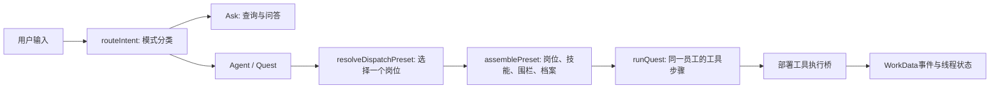
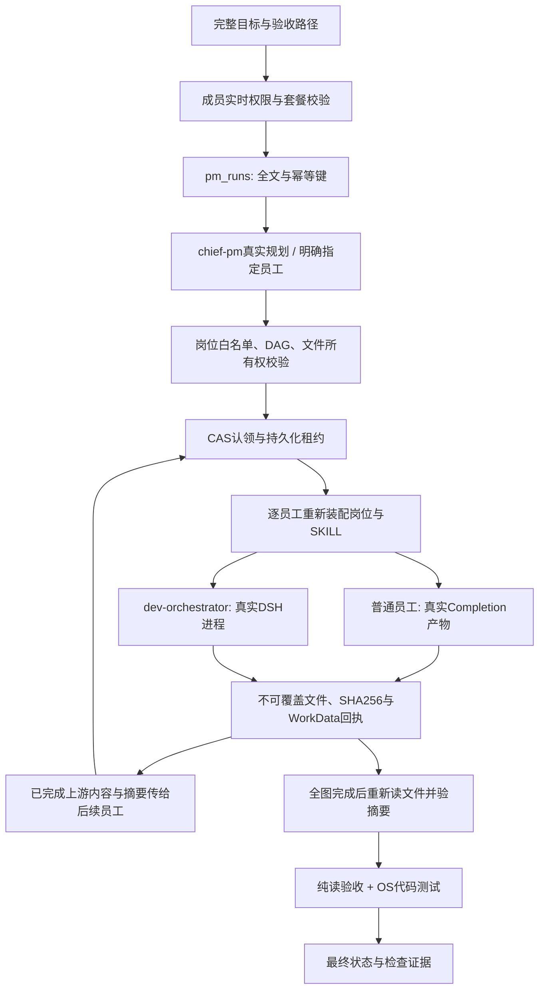

# WorkLoom PM：从目标到交付的实际链路

本文描述本次从 WorkLoom IM `e5d76398484cac7d8ac50b6c27905765a59fd50f` 派生的 PM 产品实现。代码精读证据标为 A，测试与运行回执标为 B，未实测的推断标为 D。真实成绩、失败样本和费用以 [PM-EVALUATION.md](PM-EVALUATION.md) 为准。

## 服务对象与需求边界

使用者是提出业务目标的产品负责人，以及需要需求、代码、测试与交付资料的小型研发团队。系统减少三项重复劳动：在角色之间复制上下文、把目标翻译成任务依赖、核对模型声称的完成是否有真实文件和验证依据。[A]

本轮假设为本机单用户、一个独立数据库、合成研发需求，不接生产客户数据。创建接口立即保存并返回，长工作在后台执行；单次计划最多八节点，按拓扑顺序串行执行。多员工协作已经形成真实依赖关系，但不表示并行调度或无限长自治任务。[A]

| 场景 | 用户原有困难 | 本次可检查的行为 |
|---|---|---|
| 定义反馈收集功能 | 想法缺少范围、字段和验收 | 需求岗位输出用户场景、P0/P1/P2、字段与逐例验收 |
| 实现待办模块 | 文档、实现和测试由人手工串联 | 产品经理拆分需求→开发→评测→交付；开发节点读上游文件并写真实模块与测试 |
| 修复版本质量问题 | “测试通过”与真实发布证据混在一起 | 明确模型摘要评审、考试和代码运行的不同证据；缺项停止完成或发布 |

P0 是完整目标、真实分工、岗位装配、限定工具、持久化状态、产物摘要、失败关闭和可回读回执。没有这些行为，用户仍须手工核对每次交付。P1 是更大的真实任务集、跨平台 OS 验证后端与持续质量回归。P2 是经单独权限与连接器验证的外部研发、知识和发布接入。[A/D]

本轮默认不执行生产发布、主干写入、资金、客户外发、真实红队攻击、任意宿主命令或任意互联网项目的依赖安装。其它行业资产完整保留，不能因复制完整就推导其生产连接器已验收。[A]

## 原系统如何处理意图

原链路有一次模式分类和一次岗位选择，职责不同。[A]

`packages/runtime/src/intent.ts` 的 `routeIntent` 可调用 `LlmIntentClassifier`，超时或异常走显式规则回退；`ask/agent/quest/clarify` 只是在决定交互模式。`apps/server/src/runtime/dispatch-routing.ts` 与 `thread-runner.ts` 再根据语义、行业默认、Bundle 编排岗位和兜底选择员工。这不是两遍相同的“理解用户意图”。[A]

原 AI-PM 包的 `chief-pm` 是 coordinator，原通用缺省选择逻辑优先 orchestrator；因此不能把原通用派遣等同于由产品总监拆分全体研发员工。原 Quest 是一个岗位下的有限顺序工具步骤，未把员工身份与跨岗位依赖作为任务图节点。若部署没有执行桥，部分工具只提供模拟或“未核实”路径，不能从步骤状态推导软件已交付。[A]

历史 FAQ 的 36/36 是 C 端 FAQ 集上的检索成绩，既不是研发岗位召回率，也不是复杂项目端到端达成率。必须另建任务集、明确正确岗位、保留分母和失败样本。[A]

## 新增的 PM 团队层

PC `/development` 的团队页面通过 `/api/pm` 提交完整目标。指定 employee 时跳过收费规划，形成该员工的单节点；未指定时由 `chief-pm` 生成岗位 DAG。它是独立入口，不会默默把旧 IM 的所有聊天任务改为多员工自治。[A]

核心实现位于 `apps/server/src/industry/ai-pm/`：`contract.ts` 管合同，`employees.ts` 验安装与技能摘要，`policy.ts` 管内部沙箱动作与原围栏的合并，`store.ts` 管事务与状态，`artifacts.ts` 管文件，`service.ts` 管调度，`router.ts` 管 HTTP 权限。[A]

每员工收到自己的角色提示、技能正文、完整原目标和已完成祖先的产物内容与 SHA256。只读到了哪个材料、输出了哪个文件，都可以沿依赖和回执追溯。技能文字不会自动变成网络、数据库、shell 或发布权限。当前普通员工生成的是内部文件产物，不等于运行了其 SKILL 中提到的所有原业务 handler。[A]

规划和员工回执由服务端绑定实际装配的 Bundle 版本、规范化 manifest 摘要、岗位摘要、每份技能及拼接正文摘要；执行器自报的同名来源字段会被移除。五份涉及门禁、回退、统计和 PRD 的技能还须通过结构化证据合同。当前源包为 `3.0.1` candidate，未把它伪装为已在原任务数据库中重新安装：只读矩阵的注册检查为14/14员工、20/20技能，但正文摘要只有15/20与新源一致。PM 团队层读取并校验源资产；继承技能展示注册仍保留原数据库内容。[A+B]

普通员工只有一个 outputRef 时，文件路径由服务端绑定，模型只返回正文，避免长文档在 JSON 包装中重复或截断。多文件任务使用结构化合同；只允许把字符串中原始控制字符做等价 JSON 转义、折叠同路径且逐字节相同的重复副本，并记录原响应、规范化与产物摘要。冲突重复、尾部多余结构、缺括号或 length 截断均拒绝，不猜测补全文本，也不自动付费重试。[A+B]

## 数据模型与状态

迁移 `packages/db/migrations/0043_pm_team.sql` 新增三张表。[A]

| 表 | 关键字段 | 一致性与索引 |
|---|---|---|
| `pm_runs` | tenant/workspace、完整 goal、idempotency_key、fingerprint、status、model_id、plan_version、planning_receipts、usage、verification、lease | scope+幂等键唯一；scope+created/status 索引；workspace+tenant 复合外键 |
| `pm_tasks` | run/task/scope、ordinal、preset_key、goal、depends_on、acceptance、output_refs、attempt、attempt_receipts、usage、adapter_receipt | run/task/scope 主键，run/ordinal/scope 唯一；任务就绪索引；scope 复合外键 |
| `pm_artifacts` | run/task/scope、path、SHA256、size、media_type、verified_at | run/scope/path 唯一；任务复合外键；禁止更新、删除的 append-only trigger |

三表均 FORCE RLS，同时约束 tenant 和 workspace。HTTP scope 来自已验签会话和实时成员关系，客户端不能指定租户或沙箱根目录。每次业务变更和 WorkData 生命周期事件在同一个事务提交，事件失败则业务回滚。[A+B]

运行状态为 created/planning/running/paused/blocked/failed/completed/cancelled。任务只有 CAS 认领成功才执行；并发开始不会生成第二个 worker。租约过期仅转 paused，恢复需显式触发并重新验证既有完成文件，不静默重发收费请求。上游失败使下游阻断；取消与完成加锁串行，取消后的迟到已计费响应只保留计量，不发布产物。[A+B]

已知失败用量按 attempt 去重保留，恢复后累计。缺少 usage 的调用不能被伪造为零。物理 API 费用仍以供应商回执和评测代理账本为权威，应用聚合不是供应商账单。[A+B]

## HTTP 合同

所有接口均要求当前工作区有效成员；guest、partner、readonly 被拒。写操作还要求 task.dispatch、workspace.write 与 quest 套餐能力。不会因旧 JWT 声称 owner 就跳过实时权限复核。[A+B]

装配 HTTP 路由本身不会创建数据库池或 worker。服务在实际请求通过成员中间件后才按需创建，并在同一路由实例中复用；未配置数据库也能加载通用认证入口并拒绝匿名 PM 请求。[A+B]

| 方法与路径 | 参数 / 返回 |
|---|---|
| `GET /api/pm/status` | 配置、实际后端、模型、已就绪员工、检查范围和明确边界 |
| `GET /api/pm/runs?limit=20` | 当前 scope 的运行列表 |
| `POST /api/pm/runs` | `{goal,idempotencyKey,employee?,checks?}`；首次201，完全相同幂等200，冲突409；仅创建 |
| `GET /api/pm/runs/:id` | run、tasks、artifacts，以及用量、依赖和各次回执 |
| `POST /api/pm/runs/:id/start` | 空对象；202，后台执行 |
| `POST /api/pm/runs/:id/resume` | 空对象；只允许paused/failed/blocked，先验证已完成产物 |
| `POST /api/pm/runs/:id/cancel` | 空对象；持久化取消，后续禁止发布新文件 |
| `GET /api/pm/runs/:id/artifacts?path=...` | 服务端核验摘要后返回内容、SHA256、大小与任务归属 |

goal 上限32000字符、请求体256KiB、八任务、单员工十二文件、单文件256KiB、单员工总产物1MiB。HTTP checks 只支持 fileExists/fileContains/json 的纯读断言，不能传命令、代码执行器或宿主绝对路径。路径拒绝越界、隐藏目录、符号链接、大小写冲突和目录前缀冲突。[A+B]

常见失败包括 INVALID_INPUT、RUN_STATE_CONFLICT、MODEL_DRIFT、FENCE_REVIEW_REQUIRED、ARTIFACT_HASH_MISMATCH、RUN_CHECK_FAILED、MODEL_BUDGET_EXHAUSTED。5xx 返回可追踪 ref，不直接把底层数据库或配置错误交给浏览器。[A+B]

## DeepSeek Harness 到底负责什么

当前研发节点真实执行仓库锁定的 `@deepseek-ai/dsh@0.2.1-rc.2`，不是把本地 fixture 门禁成绩当作真实模型成绩。该版本于 2026-10-17 发布，发布说明明确适配 `DeepSeek-V4.1-Flash-1017` 与 Search/Fetch API；它仍是 npm `latest` 指向的预发布版本，不能当作不可变最新版本声明。官方发布源为 [DeepSeek Harness Releases](https://github.com/deepseek-ai/deepseek-harness/releases)。[A+B]

`dsh-adapter.ts` 为每员工创建受限 profile、私有目录与会话，模型请求经父进程 CompletionProvider 发出。子进程只有随机 loopback 哨兵，不收到供应商真实 Key。只允许 list_files/read_file/write_file，写入严格限于该任务 outputRefs；不开放 shell、任意抓网页、插件管理、子代理或生产动作。上下游文件与真实 JSONL 会话、结束状态、进程退出和最终文件一并核对。[A+B]

因此，Harness 的位置是**某个员工内部的“模型请求→工具调用→工具结果→下一轮模型”循环**。产品经理决定谁做什么，团队层持有 DAG，Harness 不会天然理解产品组织或接管所有岗位。普通岗位默认走 Completion；只有实际 adapterReceipt 标明 Harness 的节点才算使用了 Harness。[A]

客户端载荷必须包含 DSH 及其完整第三方嵌套、peer 依赖。npm 安装成功和版本字符串都不足以证明可运行；本轮另在实际 runtime stage 运行了受限 CLI 任务。原全局删除 nested node_modules 的打包清理已改为只清 workspace 包内部副本，required peer 由锁与目录门禁验证。[A+B]

## 代码运行与“通过”的含义

生成代码在 macOS Seatbelt 的 deny-default OS profile 下执行，叠加 Node24 权限、清环境、无网络、宿主文件隔离、超时、内存与输出限额。当前支持零依赖 JavaScript；其它代码语言没有对应 OS 验证器时失败关闭，不以文件存在替代运行。macOS `sandbox-exec` 已被系统标为 deprecated；这是本轮本机验收后端，跨平台生产部署需要经过独立验证的容器或 OS 后端。[A+B]

固定 supervisor 不导入项目代码；Node 测试在受限子进程运行。普通 stdout 是不可信日志，不能靠打印 TAP“通过”伪造检查。监督进程消费真正测试事件并以一次性随机回执返回结构化计数，未运行测试、skip-only、取消、超时、输出洪泛或失败均不通过。[A+B]

可信 child preload 在项目导入前锁定断言库、测试断言注册、相关语言对象及内置模块加载出口；真实负向用例覆盖 ESM/CJS 断言替换、反射修改、`Module._load`、builtin cache 和加载 hook。修复前确实出现过错误代码假通过，原回执保留；修复后对应实际断言失败。这是所测攻击向量的回归，不是对任意恶意 JavaScript 的形式化隔离证明，支持范围仍限于已声明的 Node 后端。[A+B/D]

模型生成的测试仍可能遗漏业务要求，因此回执标为 generated。复杂项目另用事先编写、未交给模型改写的 trusted-evaluator 断言验证接口、边界、状态不变性和长目标尾部要求。这个有限任务集的成功不能外推为任意软件均能自主交付。[A+B/D]

## 模型、搜索、预算与恢复

默认请求 ID 是 `deepseek-flash`。官方文档在本轮核实时映射到 V4.1-Flash-1017，别名仍可漂移；每次保留响应 model/id/usage，不把别名写成不可变版本锁。[DeepSeek 官方文档](https://api-docs.deepseek.com/)

Flash 的搜索由显式 function tools 调用 DeepSeek Search/Fetch；Responses 原生 web_search 在 Flash 上被忽略。是否真的搜索要看工具请求与来源回执，不能从模型名字推断。默认 PM 文档员工未自动获得外网搜索权限；基于给定来源包写简报与重新联网核实是两种证据。[Search 文档](https://api-docs.deepseek.com/guides/search/)，[Responses 文档](https://api-docs.deepseek.com/guides/responses_api/)。

本轮真实评测用 `scripts/pm-budget-proxy.mjs` 在每次物理请求前占额：至多40请求、30万保守token额度、120元成本估算、45分钟原始运行时钟。官方V4.1分词器计算输入，明确输出上限并加协议预留；搜索/抓取也占请求槽，token等价额度与真实模型token分列。未知网络结果或用量冻结，禁止自动重试与换模型；进程重启沿用原账本，不重置调用上限或时钟。[A+B]

上述总额度是本次评测代理的保证。直接用供应商 Key 启动普通源码进程时，团队合同仍限制每次计划和员工调用数，但不会自动继承这份跨进程评测账本。生产化还需把这类统一预算边界纳入部署，而不能把评测闸门当作所有部署的默认配置。[A/D]

客户端包含真实模型适配、默认型号和运行时配置入口，Key 通过启动环境注入。源码、前端资源和可分发载荷不包含本次真实 Key。[A+B]
